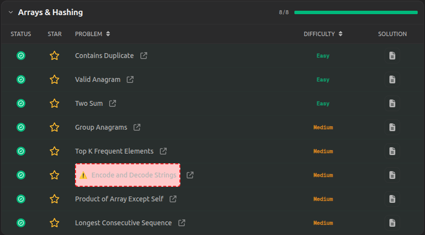

# NeetCode ↔ LeetCode Sync Checker

A small Chrome extension I built for my own LeetCode practice workflow.

I use [NeetCode](https://neetcode.io/) to follow a problem list and [LeetCode](https://leetcode.com/) to actually submit solutions. The two can get out of sync, especially when I tick a problem off on NeetCode but never got an accepted submission on LeetCode.

This extension compares my NeetCode progress against my accepted LeetCode submissions and highlights problems that are marked solved on NeetCode but not actually solved on LeetCode.



## What it does

- Fetches my solved-problem data from LeetCode using my existing logged-in browser session.
- Reads my completed problems from NeetCode (using my NeetCode login).
- Compares the two lists, mapping NeetCode's problem names to LeetCode's (e.g. `duplicate-integer` -> `contains-duplicate`).
- Lists the mismatches in the popup and highlights them in red on the NeetCode page.
- Runs locally in the browser; there is no backend or external database.

## Why I built it

I did not want another study tracker.

I wanted a small tool that fixed one annoying part of my own workflow: keeping my NeetCode checklist consistent with what I had actually solved on LeetCode.

The project started as a personal utility rather than a product.

## How it works

At a high level:

```text
NeetCode page
     |
     v
Read completed problems
(NeetCode API, falls back
 to localStorage / page)
     |
     +--------------------+
                          |
                          v
                  Fetch LeetCode
                  accepted problems
                          |
                          v
                    Compare sets
                          |
                          v
              Highlight mismatches
```

The extension uses LeetCode's internal `/api/problems/algorithms/` endpoint and NeetCode's own progress endpoint, both with the browser's logged-in sessions. The popup shows a short log of what each step found, which helps when one of the sites changes.

Only expanded sections on the NeetCode page can be highlighted, but the popup always lists every mismatch.

## Installation

This is a personal/local Chrome extension, so it is installed through Chrome's Developer Mode.

1. Clone the repository:

   ```bash
   git clone https://github.com/colin-110/neetcode_leetcode_syncer.git
   cd neetcode_leetcode_syncer
   ```

2. Open `chrome://extensions` in Chrome.
3. Enable **Developer mode**.
4. Choose **Load unpacked**.
5. Select the cloned repository directory.

## Privacy

The extension is intended to run locally in the browser. It does not use a backend or send progress data to a third-party service.

It does rely on your existing LeetCode browser session to read your solved-problem data. The LeetCode endpoint used here is an internal endpoint and may change without notice.

## Limitations

This is a personal utility, not a polished Chrome Web Store product.

Because it depends on NeetCode's page structure and LeetCode's internal API, changes to either site may require updates to the extension.

## Tech

JavaScript · Chrome Extension APIs · DOM manipulation · Fetch API

## License

MIT
